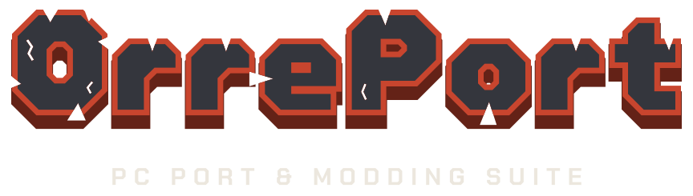

<p align="center">
  <picture>
    <source media="(prefers-color-scheme: light)" srcset="docs/images/orreport-logo-light.svg">
    
  </picture>
</p>

# OrrePort

**Pokémon Colosseum, running natively on PC, with tools for modding it.** You need your own copy of the game.

## Download

**[Download OrrePort for Windows](https://github.com/snatcherLeo/OrrePort/releases/latest)**

**Status: first playtest (Beta 0.1).** Playable from New Game into the story on Windows 10 and 11 (64-bit), with bugs
still to find. Linux and macOS are planned. Your saves are kept with their earlier versions.

## Getting started

1. **You need** your own copy of Pokémon Colosseum (US, `GC6E01`) as a disc image, and Windows 10 or 11 (64-bit).
2. **Download** the Windows zip from the [latest release](https://github.com/snatcherLeo/OrrePort/releases/latest)
   and unzip it anywhere (a USB stick works too: everything stays in that one folder).
3. **Start `OrrePort.exe`**, choose **Add a disc**, and pick your disc image. OrrePort checks it, then you press
   **Play**.
4. To play in German, French, Italian or Spanish, add your own European disc too; for Japanese, your own Japanese
   disc.

Updates are offered inside the app; nothing is installed until you choose to.

## For testers

**Playtesting?** Press **F8** in the game when something goes wrong, and OrrePort makes a report for you to share on
the Discord. [What OrrePort adds](docs/what-orreport-adds.md) lists every change from the original game.

## What it is

- **The game's own code, running natively.** Pokémon Colosseum's code was decompiled to C (from the
  [pkmn-colosseum decompilation](https://github.com/dougchansan/pkmn-colosseum)) and compiled for the PC.
  [Aurora](https://github.com/encounter/aurora) stands in for the GameCube's hardware, drawing through Vulkan or
  Direct3D 12, so OrrePort is a native PC program, not an emulator.
- **GameCube-accurate mode.** A save can be kept exactly as the console plays it, for speedrunners and RNG players:
  see [accurate mode](docs/accurate-mode.md).
- **Your saves stay yours.** OrrePort reads and writes GameCube memory card saves (`.gci`), so a save can move between
  OrrePort, Dolphin and a real GameCube: see [saves](docs/saves.md).
- **Built to be modded.** Documented, open formats ([the `.orresave` format](docs/orresave-format.md)). OrrePort Studio,
  the editor beside the game, is included as an early preview; its editors and modding support arrive in future
  updates.

## You need your own copy of the game

This repository holds code only: no game files, no disc images and no data taken from the game. OrrePort reads
everything it needs from the disc image you provide.

## How the engine works

How Pokémon Colosseum works under the hood (the formats on the disc, the battle engine, the script system and more) is
documented in a separate repository: [orre-engine-docs](https://github.com/snatcherLeo/orre-engine-docs).

## Contributing

Pull requests are welcome for engine fixes, performance, enhancements behind hook points, tools and documentation:
read [CONTRIBUTING.md](CONTRIBUTING.md) first, and the [design guide](docs/design-guide.md) for what is decided by
the project itself.

## Building from source

Windows, with [MSYS2](https://www.msys2.org/)'s MinGW-w64 GCC, CMake, Ninja and Python 3. In order:

```
python configure.py && ninja
python -I tools/local/extract.py "<your disc image>" all
python -I tools/fetch_deps.py
cmake -S port -B build-pc -G Ninja -DCMAKE_C_COMPILER=gcc -DCMAKE_CXX_COMPILER=g++ -DCMAKE_BUILD_TYPE=RelWithDebInfo
cmake --build build-pc
python -I port/tools/firstlink.py
```

1. The GameCube build first (the byte-matching decompilation, checked against the original's SHA-1; see
   [getting started](docs/getting_started.md)): the PC link reads its list of the game's source files.
2. What the build needs from your own disc image, read into `extracted/`.
3. The fonts and the GameCube adapter's library, downloaded from their official sources into `deps/` and checked
   against pinned checksums.
4. The PC build, then the link: the game lands in `build-pc/firstlink/`.

Your disc image, `extracted/` and `deps/` are ignored by git; nothing from the disc is ever committed. The full guide,
with setup and common errors: [building](docs/building.md).

## Credits

- The [Pokémon Colosseum decompilation](https://github.com/dougchansan/pkmn-colosseum) (dougchansan and contributors),
  which OrrePort is built on; its licence and notice are kept in [LICENSE](LICENSE) and [NOTICE](NOTICE).
- The HSD library code follows the structure of the
  [Super Smash Bros. Melee decompilation](https://github.com/doldecomp/melee), which uses the same library.
- [Aurora](https://github.com/encounter/aurora) (the GameCube graphics and input layer on modern APIs),
  [AxioDL's MusyX decompilation](https://github.com/AxioDL/musyx) (audio), dtk and objdiff.
- StarsMmd's Colosseum and XD research, TeamOrre and the XD decompilation community, and Count-Sheep.
- Fonts and libraries that ship with the app are listed with their licences in the app's `licenses` folder and in
  [CREDITS.md](CREDITS.md).

## Licence

OrrePort's code is [MIT](LICENSE). Third-party parts keep their own licences. Pokémon, Pokémon Colosseum and all related
names are trademarks of their respective owners, used here only to identify the game.

OrrePort is a fan project. It is not affiliated with or endorsed by Nintendo, The Pokémon Company, Game Freak or
Genius Sonority. It contains none of the game's files.
